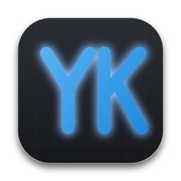

<p align="center"></p>

# YK Engine

A C++20 2D game engine and editor. Build scenes from reusable components, press **F5** to play,
and export a standalone desktop game. The editor, player and command line share the same runtime.

The repository contains two independent demo games:

| Game | Project | Play |
|---|---|---|
| **Brothers Run** | [games/brothers-run](games/brothers-run/README.md) | Two brothers, Ember and Tide, race through two platforming levels. |
| **Invisible Castle** | [games/invisible-castle](games/invisible-castle/README.md) | Two castle escape chapters with NPCs, inventories, searches, crafting and patrols. Title screen, chapter selection, controls and pause menu. |

All scenes, assets, dialogue, game text, current artwork, authoring scripts and game-specific
checks belong under `games/`. Engine code in `src/` and `include/` supplies reusable systems;
it has no dependency on either game. The editor discovers ordinary `project.ykproj` files under
`games/` and lists their names on its welcome screen and Games menu.

## Build and play

Requires CMake 3.25+, Ninja and a C++20 compiler. The first configure downloads pinned dependencies.
See [Building](docs/BUILDING.md) for Windows, macOS, dependency setup and packaging.

```sh
./scripts/build-and-run-macos.sh
```

On Windows, run `scripts\build-and-run-windows.ps1` in PowerShell. These are the only two
scripts in `scripts/`. To build and test manually:

```sh
cmake --preset dev
cmake --build --preset dev
ctest --preset dev --output-on-failure

./build/dev/yk_editor
./build/dev/yk_player games/invisible-castle
./build/dev/yk_player games/brothers-run
```

Open either project from the welcome screen and press **F5** to play in the editor.
Invisible Castle starts at its title screen. Choose either chapter with the mouse or **1 / 2**.
Use **WASD / arrows** to move, **E** to interact, **Escape** to close a popup or pause,
**P** to pause, **R** to restart, **M** for the main menu and **Tab** for chapter selection. Ember uses **A/D/W** and Tide uses the **arrow keys**;
its existing title screen and level selection are preserved.

A plain CMake configuration builds only the engine. Development presets also enable demo checks; games never enter an engine installer:

```sh
cmake -S . -B build/engine-only -G Ninja -DYK_BUILD_GAMES=OFF
cmake --build build/engine-only
ctest --test-dir build/engine-only --output-on-failure
```

The engine also supports projects anywhere outside this repository:

```sh
./build/dev/yk new ~/Games/MyGame --name "My Game"
./build/dev/yk_editor ~/Games/MyGame
./build/dev/yk export games/invisible-castle --target macos --out dist --zip
```

## Download and install

The [release folder](release/README.md) contains the current compiled apps directly in this
repository: three macOS Apple silicon `.app` bundles and three Windows x64 applications.
Use `release/downloads/` for the six portable ZIP downloads, or the root
[installers folder](installers/README.md) for setup wizards. Extract a ZIP completely before launching
its app; Windows games need their adjacent `data` and `licenses` folders.

[GitHub Releases](https://github.com/Adventnl/YK-Engine/releases) provides Windows x64 and macOS
apps and installers with three separate products for each platform:

- **YK Engine**: editor, player and command line. Starts with a blank welcome page and no game loaded.
- **Invisible Castle — Demo game**: standalone castle escape game.
- **Brothers Run — Demo game**: standalone race between the brothers Ember and Tide.

Demo installers contain one game each. To edit them, clone/download this repository and choose a
project from **Games**, or use **Open Project** on its folder. You can also open an installed demo's
`data` folder (`Contents/Resources/data` inside a macOS app). Press **F5** to play in the editor.
No compiler is needed to play or edit. Installed editors check for release updates on startup.

## Repository layout

```text
include/yk/  src/         reusable engine and gameplay systems
editor/                  editor core and interface
player/  tools/yk/        generic player and project command line
games/                  independent game projects and their checks
tests/                  engine tests and small synthetic fixtures
packaging/  cmake/       distribution and build support
docs/                   documentation
scripts/                build-and-run entry points for macOS and Windows
installers/             tracked macOS and Windows installers
```

- [Architecture](docs/ARCHITECTURE.md)
- [Building and packaging](docs/BUILDING.md)
- [Editor guide](docs/EDITOR.md)
- [Project format](docs/PROJECT_FORMAT.md)
- [Component reference](docs/components.md)
- [Dependency notices](THIRD_PARTY.md)
