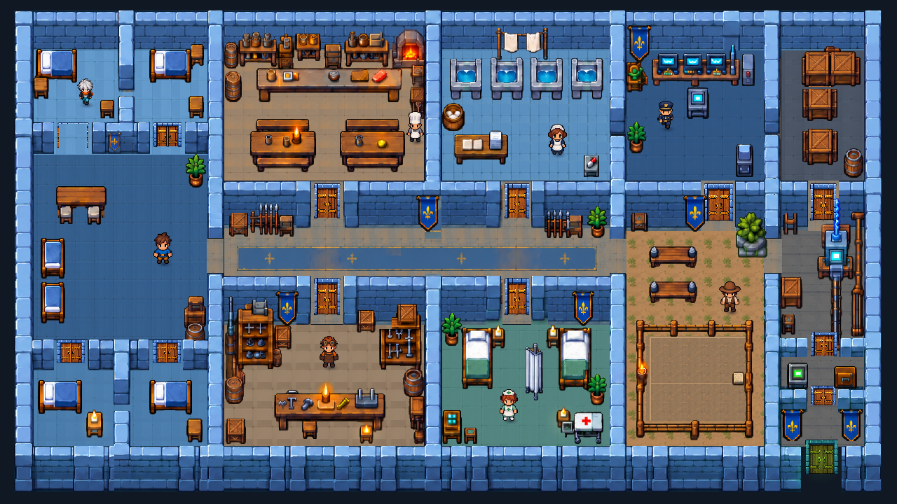

# Level 2: The Inner Keep

A furnished castle prison assembled from `invisible_castle_level2_editable.zip` in YK Engine.
The supplied five-layer composition guides the floor plan, wall elevations, prop positions,
room colors and relative furnishing scale. The previous enlarged corridor is restored to the
reference proportions. Native artwork is kept at 35 pixels per world unit.

```sh
./build/dev/yk_player YK-ExplorationDemo
```

Move with **WASD / arrows**, interact with **E**, dismiss or cancel with **Escape**,
pause with **P**, and restart with **R**. Passage doors open automatically on approach.
The camera follows the player with an 8.4-unit view and clamps to the keep boundaries.
At 1280 by 720, the world has 580 vertical pixels, or about 69 pixels per world unit.

## Escape route

1. Leave the north cell and talk to Mara in the west common room.
2. Search the southwest workshop's tool bench and tool chest for a screwdriver and wire cutters.
3. Take clean linen from the folding table in the north laundry.
4. Pry open the northeast stores' fuse cabinet with the screwdriver.
5. Wrap the fuse with linen at the workshop repair workbench.
6. Search the security desk for a security card while the guard is away. Leave control before
   the warning fills; walls and furniture block sight. Capture cancels the search and returns
   you to the cell without taking hidden tools.
7. Use the southeast utility terminal. **W/S** selects the left wire, **A/D** the right terminal,
   and **E** connects them. Match both letter and color. Incorrect pairs can be retried.
8. With power restored, cut the green exit's chain using the wire cutters, open the gate,
   and walk south. Restart clears supplies, repairs and gate state.

Every search is cancellable and grants its contents once. Crafting consumes ingredients.
NPC conversations use detailed portraits and give local hints.

## Shared visual and collision rules

Both chapters use `assets/level2/` directional character sheets and the supplied castle
materials in `assets/castle/reference/`. Room name plaques and the HUD's room label are gone.
Residents and guards use kinematic bodies with solid feet colliders: they follow their
routines and cannot be shoved out of place by walking into them. A speaker pauses while
others continue their routines.

`SpriteRenderer` contact shadows stay anchored to the feet while sprites walk, reach or
breathe. The source wall/furniture artwork retains its authored shadowing. Warm candle and
hearth glows use `Light2D`. Banners and wall-mounted controls render over their wall faces.

The new double doors use an original ImageGen master preserved in
`assets/castle/source/double-door.png`, plus an eight-frame hinged strip. `StateGate`
opens for nearby players or NPCs, waits after departure, and holds while the threshold is
occupied. Locked gates use the same new artwork and animation after their task is completed.

## Editable assets and rebuild

The supplied manifest records source origins and pivots. Scenery stays individually editable;
it is not a flattened background. `tools/castle_reference.py` imports its placements, authors
physical footprints, and opens connecting passages in the extracted wall sections. Scene
logic still uses reusable engine components for inventories, crafting, patrols, dialogue,
wire matching and level flow.

```sh
python3 YK-ExplorationDemo/tools/complete_level.py
python3 YK-ExplorationDemo/tools/build_level2.py
./build/dev/yk validate YK-ExplorationDemo
./build/dev/yk_castle_level2_tests
```

Normal rebuilds preserve existing generated character atlases; `--regenerate-art` opts into
re-exporting them. The source door master and original prompts are excluded from game exports.

Gameplay checks physically traverse the rooms and cover door approach from both sides,
intermediate/reversed frames, safe thresholds, NPC push resistance and motion, modal dismissal,
three camera viewport sizes, searches, crafting, guard capture, the wire puzzle, the sealed
exit, completion and restart. The renderer test checks actual contact-shadow pixels.

The overview below uses a temporary fixed camera for layout review. Shipping scenes follow
the character at the close zoom shown in the player preview.



