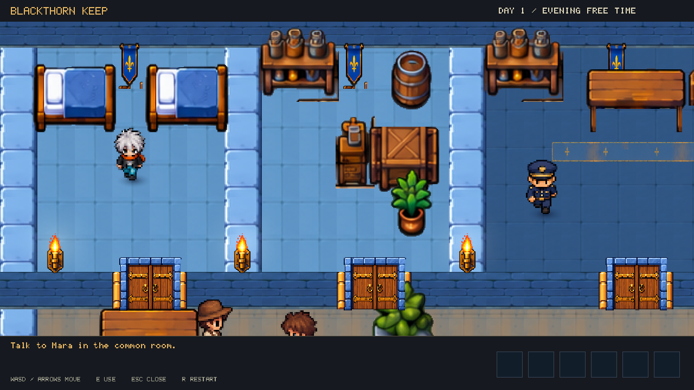
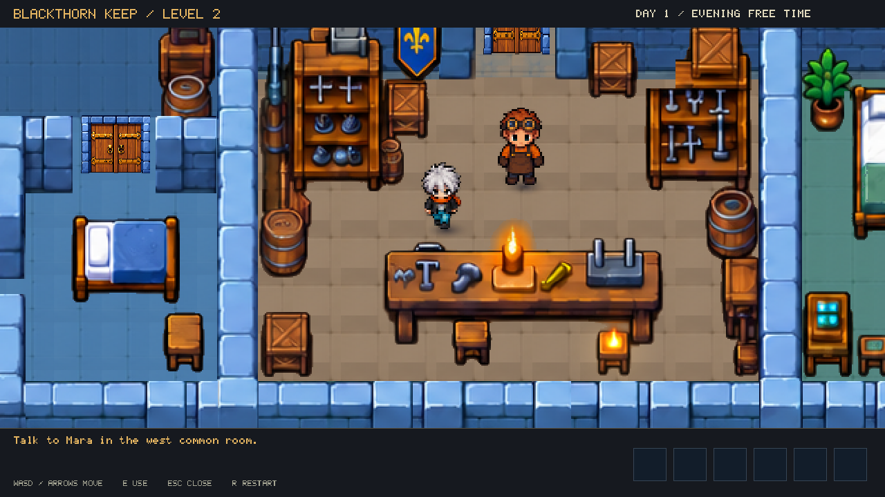

# Blackthorn Keep

Two connected castle escape chapters built in YK Engine. Both share the supplied castle's
blue stone, timber furnishings, characters, and a close character-following camera.
The project opens in **Level 2: The Inner Keep**. Chapter one remains available with
`--scene scenes/courtyard.ykscene`; completing it leads into chapter two.

```sh
./build/dev/yk_player YK-ExplorationDemo
./build/dev/yk_player YK-ExplorationDemo --scene scenes/courtyard.ykscene
```

Move with **WASD / arrows**. Press **E** near people, containers, workbenches or locked gates.
**Escape** cancels a search or dismisses a conversation. **P** pauses; **R** restarts.
Ordinary passage doors open automatically as you approach from either side, stay open while
occupied, and close after you leave. Locked escape gates retain their key, tool or puzzle requirement.

The 8.4-unit camera view is about 44% closer than the previous 12.0833-unit view.
Room plaques and the current-room header have been removed. Characters use the same
level-two directional sheets in both chapters, with grounded contact shadows. Furniture is
solid; residents and guards have kinematic bodies so the player cannot push them off their routines.

## Chapter one route

1. Talk to Mara in the common room.
2. Search the south workshop's tool bench for a screwdriver.
3. Pry open the north stores' locked cabinet for rope.
4. Search the laundry chest for an iron hook.
5. Make a grappling line at the rope workbench.
6. Search the warden desk for the brass key while the guard is away.
7. Unlock the east gate, prepare the drain grate, and walk into the drainage passage.

Searches and crafting use the engine's actual inventory, progress, cancellation and rewards.
A guard catches exposed trespassers and returns them to the cell while preserving hidden supplies.
See [LEVEL2.md](LEVEL2.md) for the second chapter's route and artwork details.

## Artwork and authoring

`assets/castle/reference/` contains the supplied editable ZIP's PNGs and original manifest.
Chapter two uses their native placements at 35 pixels per world unit. Floors, walls and props
remain separate editable entities. Doorways are cut into reconstructed wall sections to make
all rooms reachable. Chapter one uses the same floor, wall and furnishing materials.

The original door master in `assets/castle/source/double-door.png` was generated specifically
for this pass with ImageGen. `tools/castle_reference.py` exports eight hinged frames, keeping
the stone jamb still. `StateGate` reverses these frames and synchronizes them with collision.

Rebuild both scenes and the door strip without regenerating existing character atlases:

```sh
python3 YK-ExplorationDemo/tools/complete_level.py
python3 YK-ExplorationDemo/tools/build_level2.py
./build/dev/yk validate YK-ExplorationDemo
./build/dev/yk_exploration_tests
./build/dev/yk_castle_level2_tests
python3 YK-ExplorationDemo/tools/capture_previews.py
```

Pillow is required for authoring. `--regenerate-art` explicitly re-exports the earlier generated
atlases; normal scene rebuilds preserve them. The optional legacy `hall.ykscene` is separate
from this two-chapter escape route.



