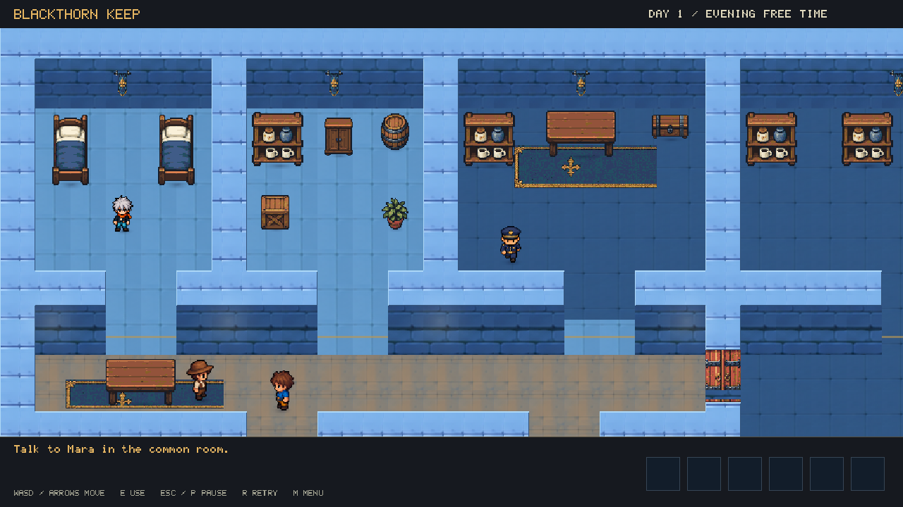
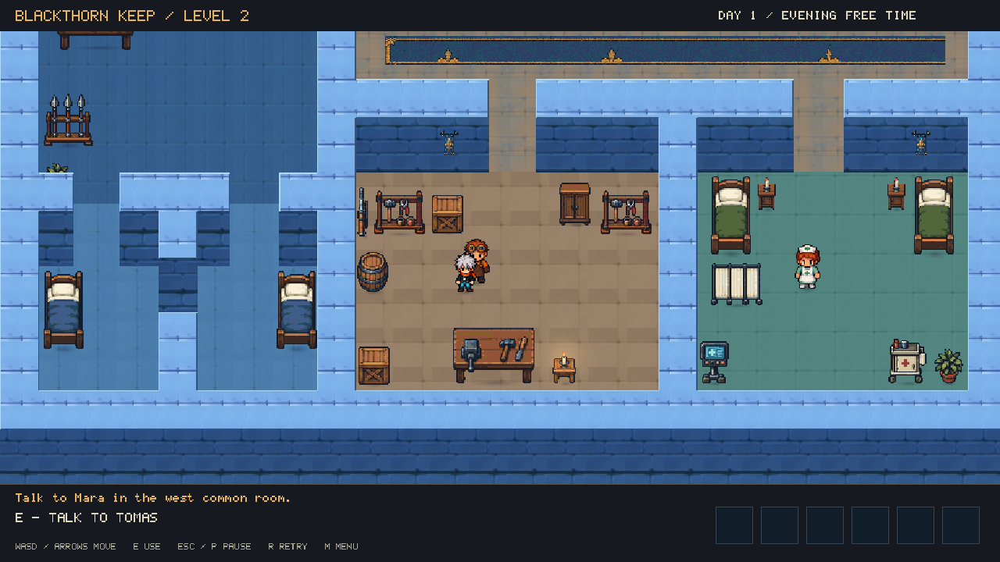
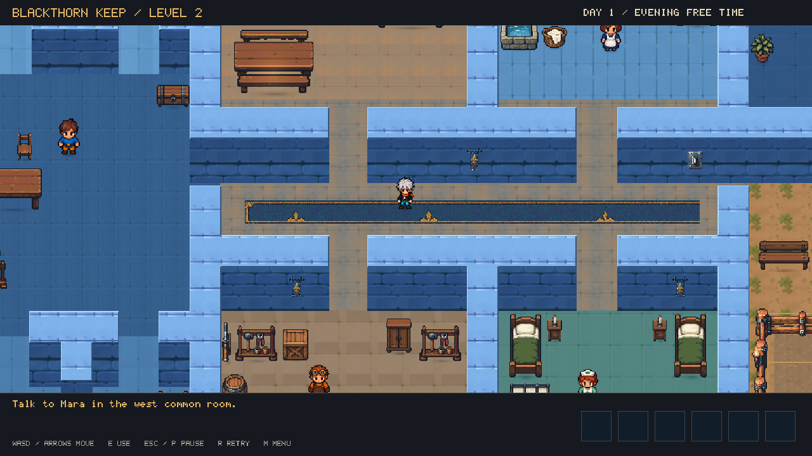

# Blackthorn Keep

Two connected castle escape chapters built in YK Engine. Both share the supplied castle's
blue stone, timber furnishings, characters, and a close character-following camera.
The project opens at its title screen. Click **Play** (or press **Enter**) to choose either
**Level 1: The Outer Hall**, the smaller introductory keep, or **Level 2: The Inner Keep**,
the full castle. Both chapters are available immediately; completing the first leads to the second.
Click **How to Play** for controls and escape tips. Keyboard chapter shortcuts are **1** and **2**;
controller shortcuts are South and North. Enter starts chapter one from the selector.

```sh
./build/dev/yk_player games/blackthorn-keep
./build/dev/yk_player games/blackthorn-keep --scene scenes/courtyard.ykscene
```

Move with **WASD / arrows**. Press **E** near people, containers, workbenches or locked gates.
**Escape** cancels a search or dismisses a conversation; otherwise **Escape / P** pauses.
The pause menu freezes the world, patrols and search progress. Click **Resume**, **Restart Level**,
**Level Select**, or **Main Menu**, or choose with **Up / Down + Enter** (D-pad + South on a controller).
**R** restarts, **M** returns to the title, and **Tab** opens chapter selection.
Completion screens wait for **Enter**: chapter one continues to the Inner Keep, and chapter two
returns to the title. Restart and menu shortcuts also work on completion screens.
Ordinary room and corridor passages have no doors; walk straight through.
Locked escape gates retain their key, tool or puzzle requirement.

The 11.6-unit camera view shows more of the surrounding rooms and passages.
Room plaques and the current-room header have been removed. Characters use the same
level-two directional sheets in both chapters, with grounded contact shadows. The hero has
separate standing and blinking frames in every direction. Releasing movement stops immediately;
holding movement against a wall keeps the character idle. Furniture is
solid; residents and guards have kinematic bodies so the player cannot push them off their routines.

## Chapter one route

1. Talk to Mara in the common room.
2. Search the south workshop's tool bench for a screwdriver.
3. Pry open the north stores' locked cabinet for rope.
4. Search the laundry chest for an iron hook.
5. Make a grappling line at the rope workbench.
6. Search the warden desk for the brass key while the guard is away.
7. Unlock the east gate, prepare the drain grate, and walk into the drainage passage.

Searches and crafting use the engine's actual inventory, progress, cancellation and rewards.
A guard catches exposed trespassers and returns them to the cell while preserving hidden supplies.
See [LEVEL2.md](LEVEL2.md) for the second chapter's route and artwork details.

## Artwork and authoring

`assets/castle/reference/` contains the supplied editable ZIP's PNGs and original manifest.
Characters, furniture, gates, floors and masonry share a 35-pixels-per-world-unit grid.
Both chapter cameras use that native raster with nearest sampling; larger windows scale
the same pixels. Furniture uses a shared 64-color palette and a single orthographic RPG
view, with visible tops and horizontal front edges. Beds and bedside furniture share that
view. Repeated objects and all banners have fixed dimensions, independent of their placement.
The blue corridor runner also has a clean cloth texture without embedded floor patches.
Floors, walls and props remain separate editable entities.

Ordinary passages are clear openings in the stone walls, with no door artwork or blocking
components. Locked escape gates use animated `StateGate` leaves and synchronized collision.
`tools/castle_masonry.py` builds both chapters from one joined stone plan. Horizontal
and vertical walls have the same 35-pixel thickness and 49-pixel elevation. The union
removes internal end caps at corners and T junctions; its surfaces are exported as
reusable 35 x 35 blocks in two compact atlases under `assets/castle/masonry/`.
Collision is partitioned from the same plan. Block edges snap together at fractional
zoom, and exposed south edges receive a face rather than an overlapping column end.
`tools/castle_geometry.py` shares furniture dimensions, silhouettes and contact shadows.
Banners share their supporting wall's depth. Clean column tiles and banner silhouettes remove
the floor scraps baked into the earlier extracted art. Repeated beds, chairs, crates, barrels,
plants and racks use shared silhouettes and dimensions. The utility machine fits inside its room
and its collision covers the pipe assembly. Furniture colliders are a merged union of the
exported opaque pixels, including real openings between legs and pipes. Transparent padding
is never solid. `castle_layout.py` authors clear aisles and intentional furniture groups;
the pixel regression test rejects overlapping furnishings in either chapter.
Chapter two's compact floor plan reduces the overall footprint by about a quarter, with
wall-mounted storage, grouped seating, adjacent bedside tables and clear passage approaches.
The final exit frame is aligned to the base of the outer wall.
Chapter one groups storage against back walls, keeps laundry basins in a work run, and
clears the circulation strip and east gate. Player collision uses a single 16 x 8-pixel
feet shape. Runtime tests approach the common-room table from above and beside it,
rejecting an invisible border larger than three native pixels.

ImageGen masters and their exact prompts are preserved in `assets/castle/source/` and
`assets/level2/source/hero_idle.*`. Runtime outputs are `assets/castle/doors/`,
`assets/castle/pixel/`, `assets/castle/masonry/` and `assets/level2/hero-polished.*`.
The older extracted and high-resolution masters are retained as source history.

Generated with the built-in image_gen tool:

- [Unified furniture, equipment and domestic sprite atlases and generation prompts](assets/castle/source/pixel-unified/prompts.json).
- [Standing hero master](assets/level2/source/hero_idle.png) and [prompt](assets/level2/source/hero_idle.prompt.txt).
- [Detailed gate master](assets/castle/source/repairs/consistency/gate.png) and [prompt](assets/castle/source/repairs/consistency/gate.prompt.txt).
- [Clean banner master](assets/castle/source/banner-clean.png) and [prompt](assets/castle/source/banner-clean.prompt.txt).
- [Furniture masters, exact prompts and export notes](assets/castle/source/repairs/README.md).
- [Fourteen spear-rack style replacements and exact prompts](assets/castle/source/repairs/consistency/README.md).
- [Earlier detailed masonry masters and exact prompts](assets/castle/source/masonry-hq/README.md).
  Shipping blocks reuse the native stone materials through `tools/castle_masonry.py`.

Rebuild both scenes and the door strip without regenerating existing character atlases:

```sh
python3 games/blackthorn-keep/tools/complete_level.py
python3 games/blackthorn-keep/tools/build_level2.py
python3 games/blackthorn-keep/tools/build_frontend.py
./build/dev/yk validate games/blackthorn-keep
ctest --preset dev -R blackthorn
python3 games/blackthorn-keep/tests/pixel_art_tests.py
python3 games/blackthorn-keep/tools/capture_previews.py
python3 games/blackthorn-keep/tools/capture_previews.py --audit
```

The frontend builder writes ordinary editable scenes and packages its chapter previews under
`assets/ui/`. Chapter builders preserve pause controls, completion flow and the title as the start scene.
The optional visual audit captures every room in both chapters and both overviews at
2560 × 1440 under `build/blackthorn-visual-audit/`, with a framing manifest.

Pillow is required for chapter authoring. `--regenerate-art` explicitly re-exports the earlier generated
atlases; normal scene rebuilds preserve them. 





